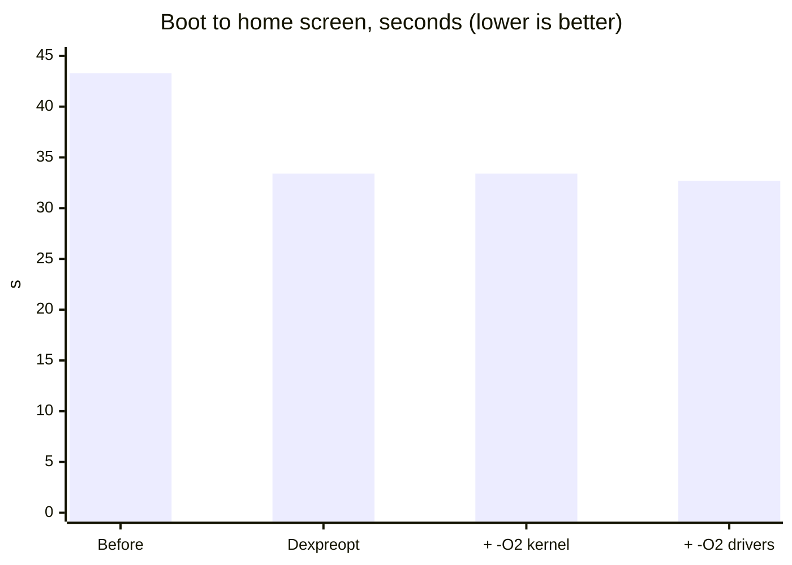

# iBall Slide Skye 03: LineageOS 15.1, measured performance

A 2018 budget tablet (Unisoc **SC7731E**, 4x Cortex-A7 @ 1.3 GHz, Mali-T820,
**1 GB RAM**, 8 GB eMMC) running **LineageOS 15.1** on its unmodified stock
Android 8.1 vendor, with the custom **KGV-Pro-X** kernel. Below is how fast it
got, and how each number was measured.

[Main repo and install guide](https://github.com/KGVHub/iball-slide-skye-03) ·
[Downloads](https://github.com/KGVHub/iball-slide-skye-03/releases) ·
[Full measurement log](PERFORMANCE.md)

## Results

All values are from the tablet itself. "Before" is LineageOS 15.1 as first
booted (no tuning); "After" is the current build.

| | Before | After | Change |
| --- | ---: | ---: | ---: |
| Boot to home screen (`sys.boot_completed`) | 43.3 s | **32.7 s** | **-24%** |
| Settings launch | 1,187 ms | **832 ms** | **-30%** |
| Camera launch | 1,677 ms | **1,127 ms** | **-33%** |
| FM Radio launch | 1,120 ms | **612 ms** | **-45%** |
| Gallery launch | 1,062 ms | **607 ms** | **-43%** |
| Idle free RAM | 427 MB | 424-444 MB | same |

```mermaid
xychart-beta
    title "App cold launch, milliseconds (lower is better)"
    x-axis ["Settings", "Camera", "FM Radio", "Gallery"]
    y-axis "ms" 0 --> 1800
    bar [1187, 1677, 1120, 1062]
    bar [832, 1127, 612, 607]
```

*First bar of each pair: before. Second: after.*

Home-screen scrolling: with the final settings, 2.6-4.8% of frames miss the
16.7 ms deadline on a fixed 20-swipe test, p99 frame time 18-22 ms.

## What made the difference

Each change was built, flashed and measured on its own, and kept only if it
won clearly. Launch times are medians of three force-stopped
`am start -W` runs, averaged over at least two benchmark rounds.

| Step | What | Effect |
| --- | --- | --- |
| 1 | **Precompile the framework and every app** (dexpreopt). Userdebug builds otherwise precompile only the boot image and system server. | Boot 43.3 → 33.4 s; launches 17-36% faster |
| 2 | **Kernel built with -O2** instead of -Os, tuned for Cortex-A7 | Launches 3-23% faster, launcher smoother |
| 3 | **GPU, WiFi, BT and FM drivers rebuilt with -O2** | Camera -14%, FM -8%, Gallery -8%, boot 32.7 s |
| 4 | **Keep all four CPU cores online.** Spreadtrum hotplug idled at one core and woke the others only after sustained 80-90% load, i.e. late in every launch. | Launcher jank 6.5% → 4.0%; Camera -10%, Settings -8% |
| 5 | **GPU minimum 384 MHz.** The Mali governor kept falling to 153.6 MHz between touches. | Smoother scrolling |
| 6 | **Lighter app-drawer transition** in the launcher (cached hardware layer instead of redrawing every frame) | Drawer swipe jank 69.7% → 29.3% |

### Tested and rejected

Kept honest: these were measured and gave no clear gain, so they are not in
the build.

- `HZ=300` kernel tick: within noise, slightly worse scrolling, 3x timer interrupts.
- eMMC `noop` scheduler and 512 KB read-ahead: about 2% on cold launches, within noise.
- More aggressive CPU governor ramp (`go_hispeed_load` 85): within run-to-run noise.

### Open item

Keeping four cores online may cost some battery at idle. The one-hour
unplugged screen-off comparison is still to be done; it is a one-line revert
if the cost is high.

## Method and tools

- `tools/scripts/perf_bench.sh`: the benchmark (app launches, launcher
  frames via `dumpsys gfxinfo`, free RAM), run two minutes after boot.
- `tools/scripts/build_modules.sh`: rebuilds the driver modules against the
  kernel; reproduces the tested modules byte for byte.
- Every result, including rejected experiments and raw values:
  [PERFORMANCE.md](PERFORMANCE.md).

## Also in this project

- KGV-Pro-X kernel with ported GPU (Mali r21p0 + devfreq), touch, WiFi,
  Bluetooth, FM, accelerometer and camera drivers.
- TWRP 3.7.0 for the device.
- LineageOS 15.1 on the stock vendor: SELinux, VNDK linker, property-length,
  VINTF, haptics and Spreadtrum FM radio fixes.
- A rescue method for a hung download mode: a hidden reset switch inside the
  side edge.

Built by kgvarunkanth with Claude Code (Anthropic) and Codex.
Source: [github.com/KGVHub](https://github.com/KGVHub)
